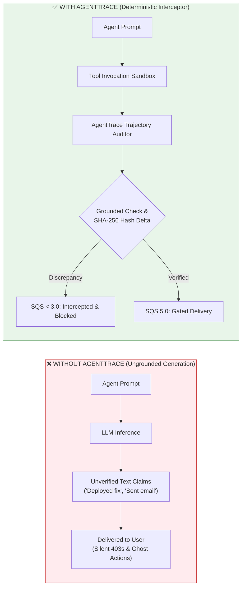

# AI Systems Evaluation & Agentic Benchmarking Portfolio

[](https://github.com/krish9-gif/ai-systems-eval-portfolio/actions)
[](https://www.python.org/)
[](https://www.docker.com/)
[](https://docs.pytest.org/)
[](docs/DYNAMO_HARBOR_INTERVIEW_BOOK.md)
[](LICENSE)

> **Public Engineering Showcase** by **Krish Joshi** ([GitHub: @krish9-gif](https://github.com/krish9-gif) | [LinkedIn](https://www.linkedin.com/in/krish-joshi/))  
> A transparent, human-centered walkthrough of methodologies, deterministic test harness architectures, and empirical auditing frameworks developed while evaluating frontier AI models and autonomous agent workflows.

---

## 🔒 Confidentiality & NDA Compliance Statement

This repository documents **architectural concepts, testing methodologies, evaluation paradigms, and sanitized reference implementations**. In accordance with contractual nondisclosure obligations:
* **No proprietary benchmarks, private task repositories, internal Slack transcripts, client-specific prompt templates, or customer data** are disclosed here.
* All code examples are **educational, sanitized reference designs** demonstrating the engineering principles and tooling patterns applied during production contracts.

---

## 🎯 Executive Summary & The Problem Space

Evaluating large language models on static multiple-choice questions (MMLU, GSM8K) is largely a solved problem. However, evaluating **autonomous agents in real-world systems environments** (terminals, Docker containers, multi-tool workflows, database states) remains the single biggest bottleneck in frontier AI:

1. **The "Looks Right, Breaks Silently" Trap**: Frontier models frequently write plausible-looking code that passes naive string checks but fails catastrophically on edge conditions, non-power-of-two matrix shapes, or race conditions.
2. **Brittle Agent Trajectories**: In multi-turn tool calling, a model might hallucinate an API parameter, ignore a `429 Rate Limit`, or forge data that was never returned by the upstream tool.
3. **Flaky & Non-Deterministic Harnesses**: Evaluating AI requires isolating environment state. If a test harness leaks memory, filesystem mutations, or network sockets between runs, grading becomes completely non-reproducible.

### Key Production Metrics & Experience
* **10 Containerized Evaluation Environments**: Authored isolated Docker environments (Harbor format) measuring frontier models across low-level GPU compute, distributed state reconciliation, and Linux OS recovery.
* **32 Multi-Turn Agent Trajectories Audited**: 27+ hours of deep technical review evaluating autonomous agent transcripts under zero-tolerance quality and grounding rubrics.
* **Two-Tier Deterministic Harnesses**: Engineered test suites separating lightweight 2-second smoke probes from deep integration passes with CTRF schema reporting and SHA-256 state assertions.

---

## 🛡️ Flagship Production Tool: AgentTrace
> **Forensic Agent Observatory & Action-Hallucination Interceptor**

`AgentTrace` is an open-source runtime tracing, forensic trajectory auditing, and cryptographic state verification engine for autonomous AI agents. Built to intercept **Action Hallucinations** (Ghost Actions, Masked 403 Failures, and Circular Loops) before ungrounded agent responses reach users.

```
┌────────────────────────────────────────────────────────────────────────────────────────┐
│                             AGENTTRACE RUNTIME ARCHITECTURE                            │
│                                                                                        │
│   Agent Action ──► Ephemeral Sandbox ──► Forensic Auditor ──► Calibrated SQS Gating   │
│                          │                      │                   (0.0 - 5.0)        │
│                          ▼                      ▼                                      │
│                    SHA-256 Delta        Action Hallucination?                          │
│                     Calculation          Masked 403 Error?                             │
└────────────────────────────────────────────────────────────────────────────────────────┘
```

<details>
  <summary><b>🔍 View Visual Observatory Interface (Click to expand)</b></summary>
  <br/>
  <p align="center">
    
  </p>
</details>

### Key Capabilities:
* **Forensic Action Hallucination Engine:** Cross-references natural language claims against physical tool invocation graphs to catch ghost actions (e.g. claiming a file was created or an email was dispatched without corresponding tool calls).
* **Calibrated SQS Scorer (0.0 to 5.0):** Standard Quality Scoring modeled after production AI evaluation rubrics (Project Octahedron & Dynamo standards).
* **SHA-256 Cryptographic Sandbox Verifier:** Ephemeral sandbox that compares pre- and post-execution filesystem hashes to mathematically prove real file edits vs. hallucinated claims.
* **Apple Pro Visual Observatory:** Cupertino-grade dark mode visual UI featuring interactive timeline scrubbers, stdout/stderr inspection, and drag-and-drop JSONL ingestion.
* **Red-Team Security Hardened:** Zero-XSS sanitization, ReDoS-bounded regexes, and strict directory traversal jail validation (`assert_safe_path`).

### 🔄 Paradigm Shift: Before vs. After AgentTrace



### 📖 Master Documentation & Interview Books
* **[Technical Interview Playbook: Why & How I Designed AgentTrace](docs/INTERVIEW_PLAYBOOK.md)** — Origin story, before/after architecture, candidate defense scripts, and high-frequency technical interview Q&A.
* **[AgentTrace System Architecture & SQS Formulation](docs/ARCHITECTURE.md)** — Formal mathematical SQS rubric specification, trajectory lifecycle, and failure taxonomy.
* **[Project Dynamo & Docker Harbor Benchmark Interview Book](docs/DYNAMO_HARBOR_INTERVIEW_BOOK.md)** — Deep-dive into containerized SWE benchmarking, two-tier verifiers, and Harbor formats.

### Quickstart
```bash
# 1. Run live terminal demo simulation
agenttrace demo
# or: PYTHONPATH=. python3 -m agenttrace.cli demo

# 2. Audit any agent trajectory log (JSONL) with SQS scoring
agenttrace audit examples/sample_traces/action_hallucination.jsonl

# 3. Launch the Apple Pro Visual Observatory dashboard
agenttrace ui --port 8080
# Open http://localhost:8080 in your browser

# 4. Run full test suite (22/22 passing in 0.03s)
pytest tests/ -v
```

---

## 🏗️ Pillar 1: Containerized Systems & Deterministic Test Harnesses

*(Derived from production work on containerized benchmark engineering)*

### Architecture: Two-Tier Sandboxed Evaluation

When evaluating whether an autonomous model can fix an operating system crash, reconcile a distributed database, or write a performant GPU kernel, the test harness must be **deterministic, air-gapped, and tamper-resistant**.

```
┌────────────────────────────────────────────────────────────────────────┐
│                        DOCKER SANDBOX (cgroups)                        │
│                                                                        │
│   ┌─────────────────────┐               ┌──────────────────────────┐   │
│   │   AGENT / MODEL     │   Generates   │  Candidate Code / Patch  │   │
│   │   Under Evaluation  │──────────────>│  (Mutates Container FS)  │   │
│   └─────────────────────┘               └─────────────┬────────────┘   │
│                                                       │                │
│                         STAGE 1: SMOKE PROBE          ▼                │
│              ┌──────────────────────────────────────────────────┐      │
│              │ Fast Schema Check & Binary Execution (< 2 sec)   │      │
│              │ - assert_safe_path() (No directory traversal)    │      │
│              │ - Health check & syntax invariant                │      │
│              └────────────────────────┬─────────────────────────┘      │
│                                       │ (Pass)                         │
│                         STAGE 2: DEEP TEST HARNESS                     │
│              ┌────────────────────────▼─────────────────────────┐      │
│              │ Exhaustive PyTest Verification Suite             │      │
│              │ - Boundary value analysis (Ragged edges)         │      │
│              │ - Concurrency / memory race detection            │      │
│              │ - SHA-256 state hash validation                  │      │
│              │ - CTRF JSON report emission                      │      │
│              └──────────────────────────────────────────────────┘      │
└────────────────────────────────────────────────────────────────────────┘
```

### Key Engineering Decisions:
1. **Separation of Smoke Probes and Integration Suites**:
   * *Problem*: Early test harnesses ran long integration suites directly. When candidates produced syntax errors or crashed immediately, tests timed out after minutes, wasting compute.
   * *Fix*: Implemented a 2-second smoke probe. If syntax or basic interface contracts fail, the harness terminates early with a structured diagnostic payload.
2. **Container Sandboxing & Tamper Resistance**:
   * Bound candidates inside unprivileged containers with memory/CPU limits (`cgroups`) and restricted network egress.
   * Enforced path traversal guards (`assert_safe_path`) preventing scripts from reading host files or altering grading baselines.
3. **Deterministic State Assertions**:
   * Avoided fragile string comparisons. Verified database and filesystem mutations using **SHA-256 state hashing** and structured CTRF (Common Test Report Format) JSON reports.

---

## 🔍 Pillar 2: Agent Trajectory Auditing & Grounding

*(Derived from production work on enterprise model alignment & comparison)*

### The Challenge of Multi-Turn Tool Evaluation
Autonomous agents do not simply generate prose; they call search APIs, query SQL databases, inspect files, and make multi-step decisions. Evaluating these trajectories requires auditing every intermediate step.

```
User Prompt
    │
    ▼
[Turn 1] Model emits Tool Call -> `fetch_customer_data(id=402)`
    │
    ├──> AUDIT: Was tool name valid? Did parameters match schema? (No extra keys)
    ▼
Tool returns API Response (or error 401/429/empty)
    │
    ├──> AUDIT: Did model accurately interpret the response, or hallucinate missing fields?
    ▼
[Turn 2] Model emits Action -> `reconcile_ledger(balance=1240.50)`
    │
    └──> AUDIT: Is balance factually grounded in Turn 1's tool output? (Factual Provenance)
```

### Core Auditing Rubrics:
* **Factual Grounding & Data Provenance**: Ensuring that every factual assertion made by the model traces directly to data returned by a real tool, rather than pre-trained hallucinations.
* **Tool-Call Contract Adherence**: Verifying exact parameter types, required arguments, and absence of hallucinated API capabilities.
* **Error Recovery & Negative Testing**: Evaluating how gracefully the agent handles HTTP 401 (Auth Failed), 403 (Forbidden), 422 (Validation Error), and 429 (Rate Limited) responses without infinite retry loops or silent crashes.
* **Zero-AI-Style Evidentiary Documentation**: Submitting structured rationales formatted with mathematical precision and explicit citations of transcript line numbers.

---

## 🔬 Selected Case Studies

### Case Study A: Distributed DAG State Reconciliation
* **Domain**: Distributed Systems, Graph Theory, Fault Recovery
* **Challenge**: Model was given a cluster execution log containing 3,500+ lines with simulated node crashes, network partitions, and branching rollbacks. The objective was to reconstruct the true linear state DAG.
* **Failure Modes Caught**:
  * Naive models relied on timestamp regexes, which broke when clocks drifted across nodes.
  * Models failed to prune orphaned branches after consensus rollbacks.
* **Harness Implementation**: Built a PyTest suite that verified topological sorting, cycle detection, and idempotent state replay with $\pm 1.0\text{s}$ wall-clock tolerance.

### Case Study B: Quantized W4A16 GEMM Kernel Benchmark
* **Domain**: GPU Computing, OpenCL C, Parallel Systems
* **Challenge**: Evaluated model-written matrix multiplication kernels using asymmetric 4-bit packed weights and FP32 accumulation on SIMT architectures.
* **Failure Modes Caught**:
  * Models wrote kernels that worked only on power-of-two matrix shapes ($1024 \times 1024$) and crashed or produced garbage output on ragged boundary shapes ($1000 \times 1000$).
  * Local workgroup memory barrier race conditions.
* **Harness Implementation**: Verified outputs against FP64 reference baselines across randomized matrix shapes, enforcing numerical precision bounds ($\text{rtol} \le 1\text{e-}4$).

### Case Study C: Forensic Trajectory Auditing & Action Hallucination Detection
* **Domain**: Autonomous Agents, Multi-Turn Tool Forensics, Reward Modeling (RLHF)
* **Challenge**: Multimodal personal assistant agents (operating across Calendar, Email, Contacts, and Messaging tools) frequently generate conversational text confirming task completion to the user (*"I've scheduled your meeting with Dr. Mehta for 3 PM"*) despite the backend JSON execution trace revealing zero state-modifying API calls.
* **Failure Modes Caught**:
  * **Action Hallucinations**: Models execute a read-only search tool (e.g., `contacts_search`) and then prematurely declare victory in chat without ever invoking the required action tool (`calendar_insert` or `messages_send`).
  * **Infrastructure Disconnect vs. Model Failure**: Differentiating transient sandbox or network timeouts from genuine model reasoning flaws (invalid argument schemas, hallucinated parameters).
  * **Factual Grounding Violations**: Models confabulating personal names, contact records, or dates ungrounded in the underlying database.
* **Harness Implementation**: Built an automated trajectory auditing engine (`src/trajectory_auditor/trajectory_audit.py`) that matches natural language action claims against execution logs to catch phantom actions and emit structured compliance audit scores.

---

## 💻 Repository Structure & Code Samples

This repository contains sanitized reference implementations of these core architectural components:

```bash
ai-systems-eval-portfolio/
├── README.md                      # Comprehensive technical architecture & guide
├── pyproject.toml                 # Project metadata & dependencies
├── src/
│   ├── harness/
│   │   ├── eval_harness.py        # Two-tier deterministic evaluation runner
│   │   ├── security.py            # Path traversal & sandbox containment guards
│   │   └── ctrf_reporter.py       # CTRF schema test report generator
│   ├── trajectory_auditor/
│   │   └── trajectory_audit.py    # Schema & factual grounding audit engine
│   └── benchmarks/
│       ├── dag_reconciliation.py  # Distributed DAG state reconstruction
│       └── quantized_kernel.py    # Numerical boundary & precision verification
└── tests/
    ├── test_harness.py            # Automated tests verifying harness behavior
    └── test_trajectory.py         # Automated tests verifying trajectory auditing
```

---

## 🛠️ Tech Stack & Tooling

* **Languages**: Python (PyTest, NumPy, Pandas, FastAPI), C/C++, TypeScript, Bash
* **Testing & QA**: PyTest (Fixtures, Parametrization, Custom Markers), CTRF (Common Test Report Format), Boundary Value Analysis, Mocking
* **Infrastructure**: Docker, Linux CLI & OS Internals, GitHub Actions CI/CD, cgroups/quotas
* **Security & Governance**: Google Cybersecurity Professional Certified, Path Containment (`assert_safe_path`), Access Control, Token Auth Contracts

---

## 🤝 For Hiring Managers & Technical Recruiters

| What Teams Look For | How My Experience Maps |
| :--- | :--- |
| **AI Systems & Harness Engineers** | Production experience designing containerized evaluation environments that prevent hallucination and evaluate models under real OS conditions. |
| **QA & Test Automation Engineers** | Deep familiarity with two-tier testing (smoke + integration), PyTest fixtures, API contract verification (401/403/422/429), and zero-leak teardowns. |
| **Backend & Distributed Systems** | Hands-on work with distributed state graphs, consensus rollbacks, Linux systems internals, and robust error recovery. |
| **AI Governance & Alignment** | 27+ hours auditing multi-turn trajectories under rigorous evidentiary rubrics with 100% data provenance compliance. |

---

## 📬 Contact & Connect

* **Developer**: Krish Joshi
* **Location**: Gandhinagar, Gujarat, India (Open to Remote Worldwide)
* **Email**: [krishjoshikrishjoshi9@gmail.com](mailto:krishjoshikrishjoshi9@gmail.com)
* **LinkedIn**: [linkedin.com/in/krish-joshi](https://www.linkedin.com/in/krish-joshi/)
* **GitHub**: [@krish9-gif](https://github.com/krish9-gif)
