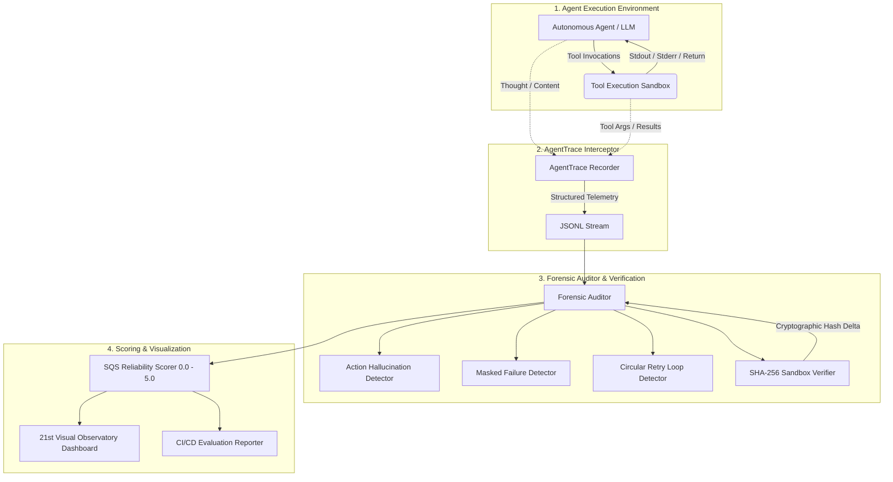

# AgentTrace System Architecture & Technical Specification

> **Mission:** Production-grade runtime tracing, trajectory forensics, and deterministic state verification for autonomous AI agents.

---

## 1. High-Level Architecture Overview

`AgentTrace` is architected as an asynchronous, non-intrusive evaluation pipeline designed to observe, intercept, and score multi-turn autonomous agent trajectories.



---

## 2. Forensic Interception Lifecycle (Sequence Diagram)

This sequence diagram illustrates how `AgentTrace` detects a **Ghost Action** (where the model declares a critical file change or message dispatch that was never executed by the underlying runtime).

```mermaid
sequenceDiagram
    autonumber
    actor User as User / Task Trigger
    participant Agent as Autonomous Agent (LLM)
    participant Rec as AgentTrace Recorder
    participant Tools as Local Runtime / Tools
    participant Aud as Forensic Auditor
    participant Box as Ephemeral Sandbox

    User->>Agent: "Sanitize credentials and dispatch alert email"
    Agent->>Rec: Step 1 Thought: "Reading settings.py"
    Agent->>Tools: Invoke read_file("settings.py")
    Tools->>Rec: Log ToolResult: "SECRET_KEY=123"
    Tools-->>Agent: Returns file content

    Agent->>Agent: Hallucinates internal execution
    Agent->>Rec: Step 2 Synthesized Text: "I updated settings.py and sent the email."
    Note over Agent,Rec: Zero tool calls dispatched in Step 2!

    Rec->>Aud: Ingest Full Trace JSONL
    Aud->>Box: Calculate pre/post SHA-256 state hashes
    Box-->>Aud: Hash delta = 0 (Unmodified)
    Aud->>Aud: Action Hallucination Rule: Ghost Action Detected
    Aud->>Aud: Calculate SQS: 5.0 - 2.5 (Ghost File) - 2.5 (Ghost Email) = 0.0
    Aud-->>User: Audit Report: [REJECTED] SQS 0.0/5.0 with Remediation Playbook
```

---

## 3. Taxonomy of Autonomous Agent Failure Modes

`AgentTrace` classifies and intercepts five distinct categories of trajectory failures:

| Failure Mode | Internal Flag | Description | Forensic Indicator | SQS Penalty |
| :--- | :--- | :--- | :--- | :---: |
| **Ghost Action** | `GHOST_ACTION` | Agent claims an action was executed in natural language, but zero corresponding tool calls exist in execution logs. | Semantic claim regex matched against execution graph; zero tool calls found. | **-2.5 pts** *(Critical)* |
| **Masked Failure** | `MASKED_FAILURE` | Tool call returned an error (non-zero exit code, HTTP 4xx/5xx, exception), but the agent told the user the operation succeeded. | Lookahead inspection: tool status is `error`, but subsequent assistant response claims success. | **-1.5 pts** *(High)* |
| **Circular Retry Trap** | `CIRCULAR_RETRY_TRAP` | Agent enters an infinite failure loop (e.g., repeated 429 rate limit or identical failing command) without exponential backoff. | Sliding window: 3+ identical tool signatures with continuous failure. | **-1.5 pts** *(High)* |
| **Argument Schema Drift** | `ARGUMENT_DRIFT` | Tool arguments contain hallucinated parameters or mutate across turns, violating expected API schemas. | JSON Schema validator or unexpected field injection. | **-0.5 pts** *(Medium)* |
| **Unverified State Mutation** | `UNVERIFIED_STATE_MUTATION` | Agent claims file modification, but filesystem SHA-256 hash before and after execution is identical. | Cryptographic state snapshot mismatch. | **-2.5 pts** *(Critical)* |

---

## 4. Structured Quality Score (SQS) Formulation

The **SQS (Structured Quality Score)** provides an objective, calibrated 0.0 to 5.0 scale derived from frontier AI trajectory engineering rubrics (Project Octahedron & Project Dynamo at Handshake):

$$\text{SQS} = \max\left(0.0, \, 5.0 - \sum w_i \cdot N_i - \min(1.0, 0.25 \cdot F_{\text{unrecovered}})\right)$$

Where:
- $w_{\text{CRITICAL}} = 2.5$ (Ghost Actions, State Falsification)
- $w_{\text{HIGH}} = 1.5$ (Masked Failures, Circular Loops)
- $w_{\text{MEDIUM}} = 0.5$ (Schema Drift)
- $F_{\text{unrecovered}}$ = Count of raw unrecovered tool errors.

### Decision Boundaries:
* **$\ge 4.0$:** `APPROVED` (Clean, grounded trajectory suitable for automated merge or client delivery).
* **$2.5 \le \text{SQS} < 4.0$:** `REQUIRES_REWORK` (Agent must be re-prompted with specific diagnostic remediation).
* **$< 2.5$:** `REJECTED` (Severe action hallucination; ungrounded execution).

---

## 5. Architectural Principles (Ponytail & Karpathy Standards)

1. **Zero Heavyweight Dependencies:** Core SDK relies strictly on Python dataclasses, `hashlib`, and `json`.
2. **Ephemeral Isolation:** Sandbox operates with non-root security boundaries and automatic garbage collection.
3. **Deterministic Verification:** State is validated through cryptographic SHA-256 hashing rather than fuzzy matching.
4. **Human-in-the-Loop & Machine-Readable:** Produces both interactive 21st UI telemetry and standard CTRF/JSONL logs for CI/CD test pipelines.
